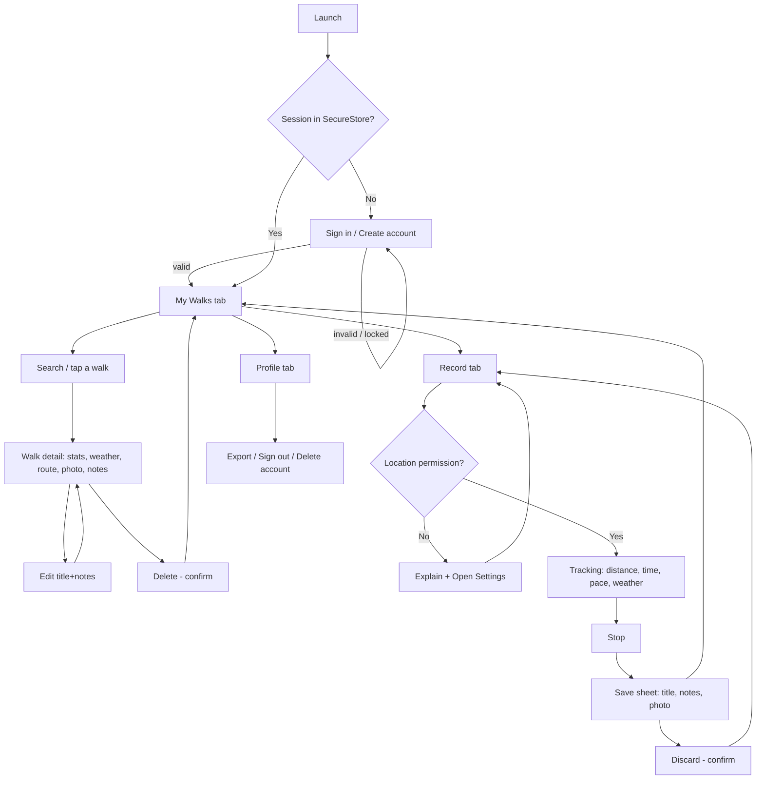

# TrailNotes – Project Proposal
**Module:** CS32005 Mobile Application Development  |  **Platform:** Android (iOS-capable) via React Native / Expo

## 1. Concept and problem
Casual walkers want a **simple, private** way to record a walk (distance, time, route), remember what the weather was like, attach a photo and write a note – without ads, accounts on a server, or battery-hungry background tracking.
**TrailNotes** is an offline-first walking journal. All data lives on the phone; the only network call is a weather lookup.

**Target users:** casual walkers/dog-walkers, students, older users who value clear large controls; including screen-reader users.

## 2. Features (scope)
| # | Feature | Mobile-specific capability |
|---|---------|----------------------------|
| F1 | Register / sign in / sign out, lockout after repeated failures | Secure credential handling, Keystore (SecureStore) session |
| F2 | Record a walk: live distance, time, pace, GPS point count | **GPS** (expo-location, foreground only) |
| F3 | Current weather at walk start | **REST API** (Open-Meteo) with timeout, cache, offline fallback |
| F4 | Attach a photo to a walk | **Camera** (expo-image-picker) |
| F5 | Save, list, search, view, edit, delete walks | **Local storage** (SQLite) |
| F6 | Route drawn from recorded GPS points | SVG rendering (no map API key) |
| F7 | Totals dashboard (7-day distance, lifetime stats) | SQL aggregation |
| F8 | Export my data (JSON) / Delete account and all data | GDPR portability & erasure |
| F9 | Simulated GPS toggle (demo/emulator) | Testability |
| F10 | Light/dark theme, large text support, screen-reader labels | Accessibility |

**Out of scope (future work):** background tracking, cloud sync, social sharing, map tiles, biometric unlock.

## 3. Design principles & patterns
* **Bottom tab navigation** (3 destinations: My Walks · Record · Profile) + **stack** for Walk detail – Material/HIG pattern, reachable by thumb.
* **Large primary actions** (Start/Stop 64 dp), all touch targets ≥ 48 dp.
* **Progressive disclosure:** Record → Stop → Save sheet (title/notes/photo) – only asks for input when it is needed.
* **Forgiving errors:** permission denied → explanation + “Open Settings”; offline → walk still saves; destructive actions confirm.
* **Colour:** green primary; every text/background pair ≥ 4.5:1 (tested), dark theme follows the OS.

## 4. User flow


## 5. Wireframes (low-fidelity)
```
 ┌ My Walks ───────────┐  ┌ Record ─────────────┐  ┌ Walk ───────────────┐
 │ ┌ Last 7 days ────┐ │  │ ┌─────────────────┐ │  │ Tue 3 Nov 2026      │
 │ │ 6.42 km         │ │  │ │ 1.24km 18:03 6:12│ │  │ [1.24 km|18:03|6:12]│
 │ └─────────────────┘ │  │ └─────────────────┘ │  │ Overcast 9°C wind 14│
 │ [ Search walks    ] │  │ Overcast · 9°C      │  │ ┌ route polyline ─┐ │
 │ ┌ Law Hill loop ──┐ │  │ [   STOP WALK     ] │  │ │   ●─╮   ╭─▲     │ │
 │ │ 2.5 km · 31:20  │ │  │                     │  │ └─────────────────┘ │
 │ └─────────────────┘ │  │ (idle state:)       │  │ [photo]             │
 │ ┌ Riverside ──────┐ │  │ [   START WALK    ] │  │ Notes…              │
 │ └─────────────────┘ │  │ Simulated GPS  (o)  │  │ [Edit] [Delete]     │
 │ Walks│Record│Profile│  │ Walks│Record│Profile│  └─────────────────────┘
 └─────────────────────┘  └─────────────────────┘
```

## 6. Architecture
`UI screens` → `AuthContext` / `repo (SQL)` / `lib (pure logic)` → `expo-sqlite`, `expo-secure-store`, `expo-location`, `expo-image-picker`, Open-Meteo.
Pure logic (`lib/`, `db/repo.ts`) has no UI imports so it is unit-testable; the repository is tested against real SQLite.

**Data model:** `users(id, username UNIQUE, display_name, salt, password_hash, failed_attempts, locked_until, created_at)` · `walks(id, user_id → users ON DELETE CASCADE, title, notes, started_at, duration_s, distance_m, route_json, photo_uri, weather_json)` · index `(user_id, started_at DESC)`.

## 7. Risks & mitigations
| Risk | Mitigation |
|------|-----------|
| GPS noise inflates distance | Reject fixes with accuracy > 50 m or implied speed > 12 m/s |
| Weather API down / offline | 8 s timeout, cache, never blocks saving |
| Password hashing blocks UI | Spinner + yield a frame; iterations tuned for mobile |
| Permission denial | Rationale text + Settings shortcut + simulated GPS |
| Screen readers / large fonts | Labels, roles, live regions, flexible layouts, contrast tests |

## 8. Test plan
Unit (Jest) · repository tests on real SQL · component accessibility tests · TypeScript strict · Android bundle build · manual device checklist (README) · short user test with 3–5 people.
